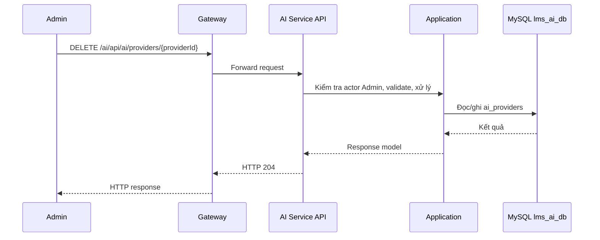

# `DELETE /ai/api/ai/providers/{providerId}` — Xóa AI provider

API contract: [`delete-provider.md`](../../api/ai-service/endpoints/delete-provider.md)

## Mục tiêu

Admin xóa provider không còn model nào.

## Actor và thành phần

- Admin (actor `ADMIN`).
- API Gateway (route `/ai/{**catch-all}`, bỏ tiền tố `/ai`).
- AI Service (Api → Application → Infrastructure).
- MySQL `lms_ai_db`.

## Điều kiện trước

- Header `X-Actor-Type: ADMIN` và `X-Actor-Id` hợp lệ.
- Body/query đúng contract trong tài liệu API.

## UML luồng chạy

## Luồng chính

1. Admin gửi `DELETE /ai/api/ai/providers/{providerId}`.
2. Handler kiểm tra provider tồn tại.
3. Repository xóa; nếu FK vi phạm thì trả `409 AI_PROVIDER_IN_USE`.
4. API trả `204`.

## Luồng lỗi

- `400`: `VALIDATION_FAILED` khi `providerId` sai.
- `403`: Actor không phải Admin (header actor thiếu/sai định dạng trả `400`).
- `404`: `AI_PROVIDER_NOT_FOUND`.
- `409`: `AI_PROVIDER_IN_USE`: provider còn model (FK `RESTRICT`).

## Dữ liệu và side effects

- Xóa 1 dòng `ai_providers`. Muốn xóa provider phải xóa model của nó trước.

## Test mapping

- Unit: [`docs/tests/ai-service/unit.md`](../../tests/ai-service/unit.md).
- Component: [`docs/tests/ai-service/component.md`](../../tests/ai-service/component.md).
