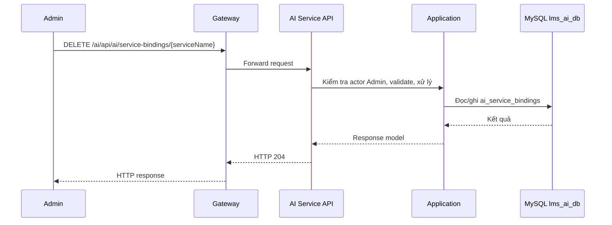

# `DELETE /ai/api/ai/service-bindings/{serviceName}` — Gỡ AI khỏi service

API contract: [`delete-service-binding.md`](../../api/ai-service/endpoints/delete-service-binding.md)

## Mục tiêu

Admin gỡ model AI đã gán cho service.

## Actor và thành phần

- Admin (actor `ADMIN`).
- API Gateway (route `/ai/{**catch-all}`, bỏ tiền tố `/ai`).
- AI Service (Api → Application → Infrastructure).
- MySQL `lms_ai_db`.

## Điều kiện trước

- Header `X-Actor-Type: ADMIN` và `X-Actor-Id` hợp lệ.
- Body/query đúng contract trong tài liệu API.

## UML luồng chạy

## Luồng chính

1. Admin gửi `DELETE /ai/api/ai/service-bindings/{serviceName}`.
2. Handler xóa binding theo `service_name`.
3. API trả `204` hoặc `404`.

## Luồng lỗi

- `403`: Actor không phải Admin (header actor thiếu/sai định dạng trả `400`).
- `404`: `AI_SERVICE_BINDING_NOT_FOUND`.

## Dữ liệu và side effects

- Xóa 1 dòng `ai_service_bindings`; model và provider giữ nguyên.

## Test mapping

- Unit: [`docs/tests/ai-service/unit.md`](../../tests/ai-service/unit.md).
- Component: [`docs/tests/ai-service/component.md`](../../tests/ai-service/component.md).
