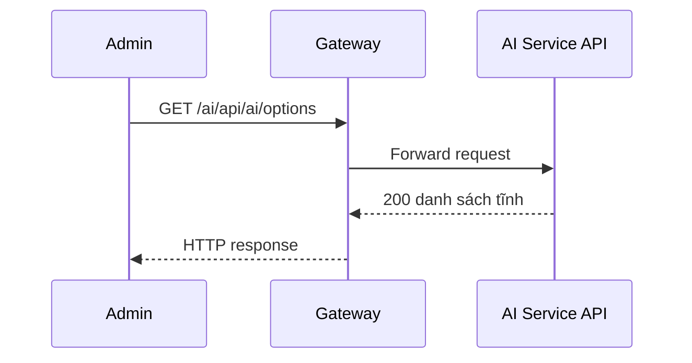

# `GET /ai/api/ai/options` — Lấy lựa chọn cố định cho UI cấu hình

API contract: [`get-options.md`](../../api/ai-service/endpoints/get-options.md)

## Mục tiêu

Trả các loại AI kèm base URL mặc định và danh sách service được phép gán, để UI dựng form.

## Actor và thành phần

- Admin (actor `ADMIN`).
- API Gateway (route `/ai/{**catch-all}`, bỏ tiền tố `/ai`).
- AI Service (Api → Application → Infrastructure).
- MySQL `lms_ai_db`.

## Điều kiện trước

- Header `X-Actor-Type: ADMIN` và `X-Actor-Id` hợp lệ.
- Body/query đúng contract trong tài liệu API.

## UML luồng chạy

## Luồng chính

1. Admin gửi `GET /ai/api/ai/options`.
2. Handler trả danh sách tĩnh.
3. API trả `200`.

## Luồng lỗi

- `403`: Actor không phải Admin (header actor thiếu/sai định dạng trả `400`).

## Dữ liệu và side effects

- Không truy cập database; dữ liệu cố định trong mã.

## Test mapping

- Unit: [`docs/tests/ai-service/unit.md`](../../tests/ai-service/unit.md).
- Component: [`docs/tests/ai-service/component.md`](../../tests/ai-service/component.md).
