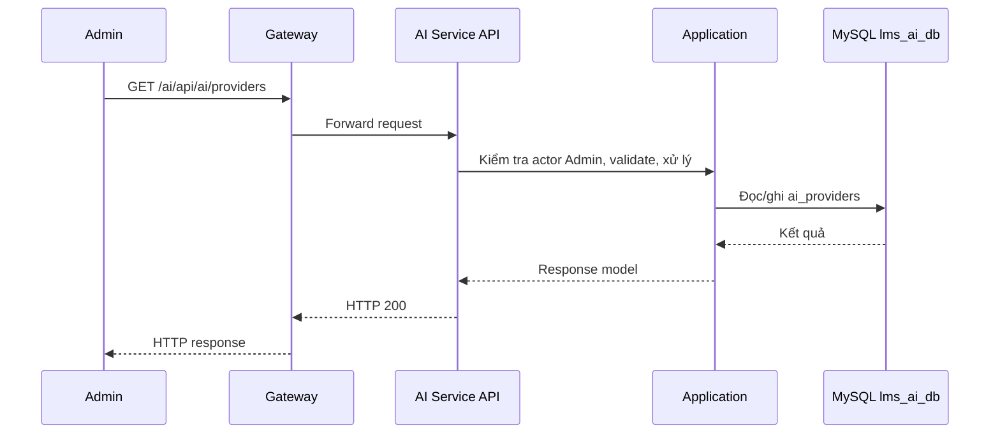

# `GET /ai/api/ai/providers` — Liệt kê AI provider

API contract: [`get-providers.md`](../../api/ai-service/endpoints/get-providers.md)

## Mục tiêu

Admin xem danh sách provider theo trang để quản lý cấu hình.

## Actor và thành phần

- Admin (actor `ADMIN`).
- API Gateway (route `/ai/{**catch-all}`, bỏ tiền tố `/ai`).
- AI Service (Api → Application → Infrastructure).
- MySQL `lms_ai_db`.

## Điều kiện trước

- Header `X-Actor-Type: ADMIN` và `X-Actor-Id` hợp lệ.
- Body/query đúng contract trong tài liệu API.

## UML luồng chạy

## Luồng chính

1. Admin gửi `GET /ai/api/ai/providers` với filter, không có body.
2. `GetAiProvidersQuery.Create` normalize filter và phân trang.
3. Repository đếm và đọc trang theo cùng predicate.
4. API trả `200` cùng `meta.pagination` kiểu offset.

## Luồng lỗi

- `400`: `VALIDATION_FAILED` khi filter hoặc phân trang sai.
- `403`: Actor không phải Admin (header actor thiếu/sai định dạng trả `400`).

## Dữ liệu và side effects

- Chỉ đọc `ai_providers`; không trả API key hay ciphertext.

## Test mapping

- Unit: [`docs/tests/ai-service/unit.md`](../../tests/ai-service/unit.md).
- Component: [`docs/tests/ai-service/component.md`](../../tests/ai-service/component.md).
