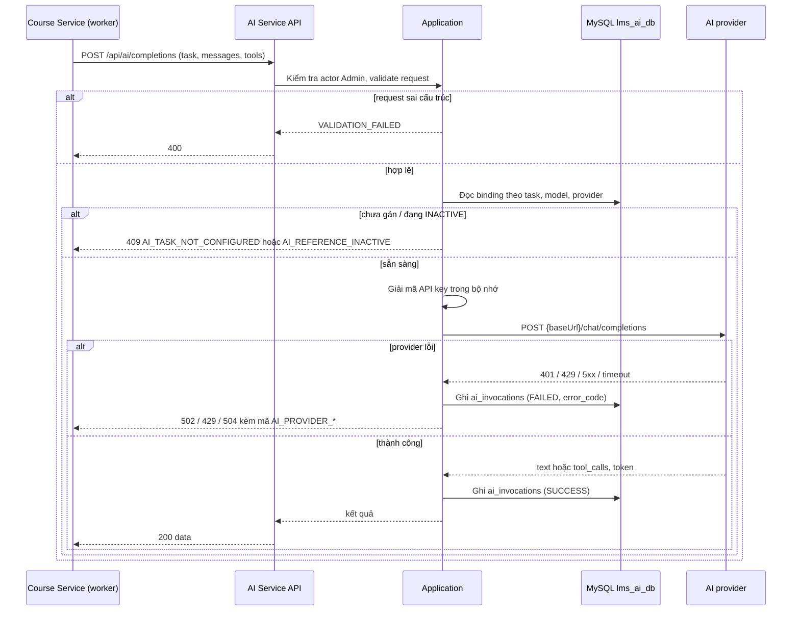

# `POST /ai/api/ai/completions` — Chạy một lượt chat completion cho một tác vụ AI

API contract: [`post-completions.md`](../../api/ai-service/endpoints/post-completions.md)

## Mục tiêu

Cho phép service nội bộ gọi model đã gán cho một khóa tác vụ (extraction, tổng hợp bài học, soạn quiz) mà không cần biết provider, base URL hay API key. Model có thể trả văn bản hoặc yêu cầu gọi tool.

## Actor và thành phần

- Course Service (worker nền) gọi bằng actor `ADMIN` của người đã yêu cầu.
- AI Service (Api → Application → Infrastructure).
- MySQL `lms_ai_db` (`ai_service_bindings`, `ai_models`, `ai_providers`, `ai_invocations`).
- AI provider bên ngoài (endpoint `chat/completions` OpenAI-compatible).

## Điều kiện trước

- Header `X-Actor-Type: ADMIN` và `X-Actor-Id` hợp lệ.
- Binding cho `task` đã được Admin gán trên trang AI → Gán model; model và provider đang `ACTIVE`.

## UML luồng chạy

## Luồng chính

1. Course Service gửi `task`, `messages` và `tools`.
2. Handler chuẩn hóa `task`, validate message/tool và giới hạn kích thước.
3. Handler tra binding, kiểm tra model và provider `ACTIVE`, giải mã API key.
4. Adapter dựng payload OpenAI-compatible (ảnh qua `image_url`, PDF qua phần `file`, tool qua `tools`), gọi provider một lần với timeout 240 giây.
5. Handler ghi `ai_invocations` và trả văn bản/`toolCalls`, token và độ trễ.

## Luồng lỗi

- `400` `VALIDATION_FAILED`: `task` không hỗ trợ, `messages`/`tools` sai.
- `403`: Actor không phải Admin (header actor thiếu/sai định dạng trả `400`).
- `409` `AI_TASK_NOT_CONFIGURED`, `AI_REFERENCE_INACTIVE`, `AI_PROVIDER_KEY_UNREADABLE`.
- `429` `AI_PROVIDER_RATE_LIMITED`; `502` `AI_PROVIDER_AUTH_FAILED`, `AI_PROVIDER_UNREACHABLE`, `AI_PROVIDER_REJECTED_REQUEST`, `AI_PROVIDER_INVALID_RESPONSE`; `504` `AI_PROVIDER_TIMEOUT`.

## Dữ liệu và side effects

- Ghi `ai_invocations` cho mọi lần gọi provider (thành công và thất bại); không lưu nội dung message và không lưu API key.
- Gọi HTTP ra ngoài tới provider; không retry tự động.

## Test mapping

- Unit: [`docs/tests/ai-service/unit.md`](../../tests/ai-service/unit.md) (`CreateAiCompletionHandlerTests`, `HttpAiChatClientTests`).
- Component: [`docs/tests/ai-service/component.md`](../../tests/ai-service/component.md) (`AiCompletionEndpointComponentTests`).
