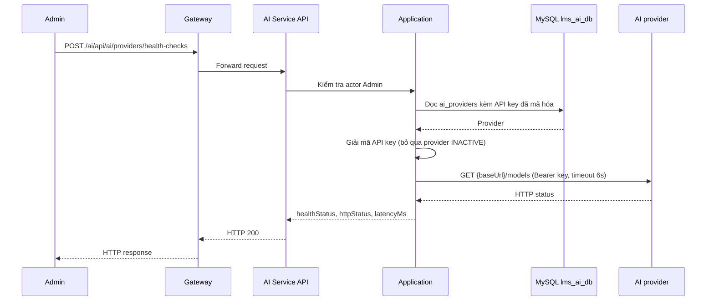

# `POST /ai/api/ai/providers/health-checks` — Thử kết nối tất cả AI provider

API contract: [`post-provider-health-checks.md`](../../api/ai-service/endpoints/post-provider-health-checks.md)

## Mục tiêu

Thử kết nối tất cả AI provider; trả trạng thái kết nối mà không lưu vào database.

## Actor và thành phần

- Admin (actor `ADMIN`).
- API Gateway (route `/ai/{**catch-all}`, bỏ tiền tố `/ai`).
- AI Service (Api → Application → Infrastructure).
- MySQL `lms_ai_db` (chỉ đọc provider và API key đã mã hóa).
- AI provider bên ngoài (endpoint `GET {baseUrl}/models`).

## Điều kiện trước

- Header `X-Actor-Type: ADMIN` và `X-Actor-Id` hợp lệ.

## UML luồng chạy

## Luồng chính

1. Admin gửi `POST /ai/api/ai/providers/health-checks`.
2. Handler đọc provider (tất cả) kèm API key đã mã hóa.
3. Provider `INACTIVE` được đánh dấu `DISABLED` và không gọi ra ngoài; provider `ACTIVE` được giải mã key rồi gọi thử `GET {baseUrl}/models`.
4. Kết quả được phân loại: 2xx → `ONLINE`; 401/403 → `AUTH_FAILED`; lỗi mạng/timeout → `UNREACHABLE`; còn lại → `ERROR`.
5. API trả `200` kèm kết quả của từng provider; lỗi mạng của provider không làm API lỗi.

## Luồng lỗi

- `403`: Actor không phải Admin (header actor thiếu/sai định dạng trả `400`).

## Dữ liệu và side effects

- Chỉ đọc `ai_providers`; không ghi database, không trả API key.
- Có một cuộc gọi HTTP ra ngoài tới base URL của mỗi provider đang bật; không theo redirect để API key không bị gửi sang host khác.

## Test mapping

- Unit: [`docs/tests/ai-service/unit.md`](../../tests/ai-service/unit.md).
- Component: [`docs/tests/ai-service/component.md`](../../tests/ai-service/component.md).
