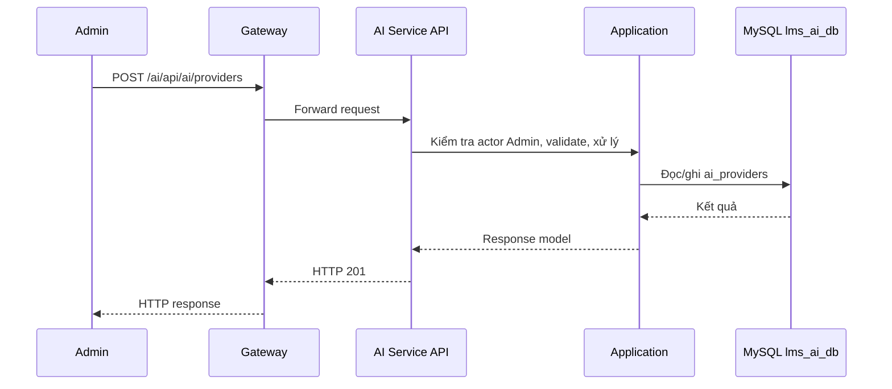

# `POST /ai/api/ai/providers` — Tạo AI provider

API contract: [`post-providers.md`](../../api/ai-service/endpoints/post-providers.md)

## Mục tiêu

Admin khai báo một AI provider (loại AI, endpoint, API key). Key được mã hóa AES-256-GCM trước khi lưu.

## Actor và thành phần

- Admin (actor `ADMIN`).
- API Gateway (route `/ai/{**catch-all}`, bỏ tiền tố `/ai`).
- AI Service (Api → Application → Infrastructure).
- MySQL `lms_ai_db`.

## Điều kiện trước

- Header `X-Actor-Type: ADMIN` và `X-Actor-Id` hợp lệ.
- Body/query đúng contract trong tài liệu API.

## UML luồng chạy

## Luồng chính

1. Admin gửi request tới Gateway `POST /ai/api/ai/providers`.
2. API kiểm tra actor Admin rồi chuyển body vào `CreateAiProviderHandler`.
3. Handler validate/normalize field, kiểm tra trùng tên, mã hóa API key bằng `ISecretProtector`.
4. Repository ghi `ai_providers`; handler trả record kèm hint.
5. API trả `201`, header `Location`, `Cache-Control: no-store`.

## Luồng lỗi

- `400`: `VALIDATION_FAILED` kèm `error.details[]` theo field.
- `403`: Actor không phải Admin (header actor thiếu/sai định dạng trả `400`).
- `409`: `AI_PROVIDER_NAME_CONFLICT`: tên provider đã tồn tại.

## Dữ liệu và side effects

- Ghi 1 dòng vào `ai_providers`: `api_key_encrypted` là ciphertext, `api_key_hint` là `****` + 4 ký tự cuối.
- Không gọi provider bên ngoài ở bước này; key chưa được kiểm tra online.

## Test mapping

- Unit: [`docs/tests/ai-service/unit.md`](../../tests/ai-service/unit.md).
- Component: [`docs/tests/ai-service/component.md`](../../tests/ai-service/component.md).
