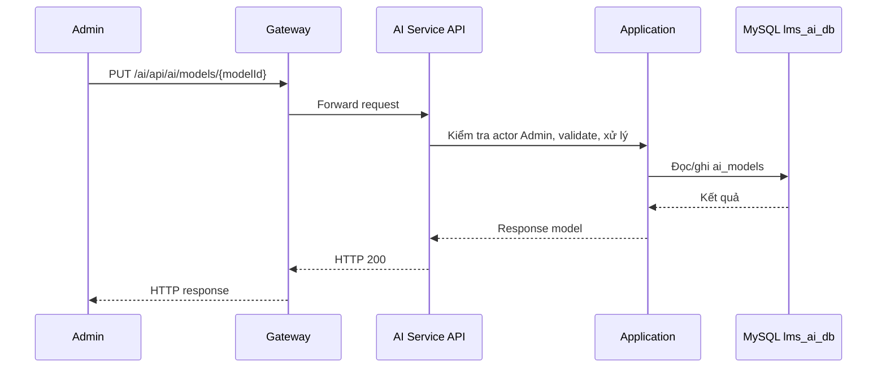

# `PUT /ai/api/ai/models/{modelId}` — Cập nhật AI model

API contract: [`put-model.md`](../../api/ai-service/endpoints/put-model.md)

## Mục tiêu

Admin sửa tên model, tên hiển thị, trạng thái. Không đổi được provider của model.

## Actor và thành phần

- Admin (actor `ADMIN`).
- API Gateway (route `/ai/{**catch-all}`, bỏ tiền tố `/ai`).
- AI Service (Api → Application → Infrastructure).
- MySQL `lms_ai_db`.

## Điều kiện trước

- Header `X-Actor-Type: ADMIN` và `X-Actor-Id` hợp lệ.
- Body/query đúng contract trong tài liệu API.

## UML luồng chạy

## Luồng chính

1. Admin gửi `PUT /ai/api/ai/models/{modelId}`.
2. Handler đọc model, validate, kiểm tra trùng `modelName` trong provider.
3. Repository cập nhật.
4. API trả `200`.

## Luồng lỗi

- `400`: `VALIDATION_FAILED`.
- `403`: Actor không phải Admin (header actor thiếu/sai định dạng trả `400`).
- `404`: `AI_MODEL_NOT_FOUND`.
- `409`: `AI_MODEL_CONFLICT`.

## Dữ liệu và side effects

- Cập nhật `ai_models`; binding trỏ tới model này giữ nguyên.

## Test mapping

- Unit: [`docs/tests/ai-service/unit.md`](../../tests/ai-service/unit.md).
- Component: [`docs/tests/ai-service/component.md`](../../tests/ai-service/component.md).
