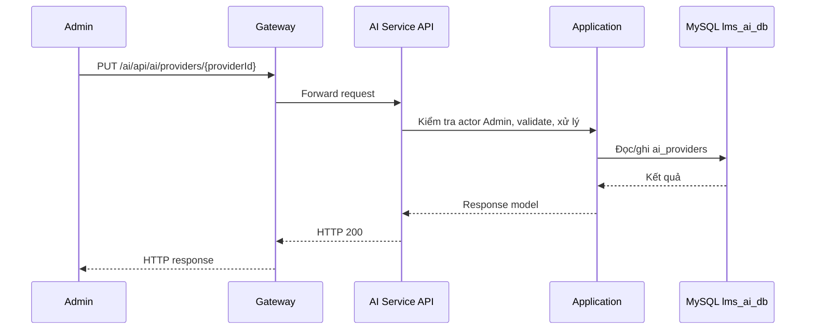

# `PUT /ai/api/ai/providers/{providerId}` — Cập nhật AI provider

API contract: [`put-provider.md`](../../api/ai-service/endpoints/put-provider.md)

## Mục tiêu

Admin sửa tên, loại, endpoint, trạng thái và (tùy chọn) thay API key của provider.

## Actor và thành phần

- Admin (actor `ADMIN`).
- API Gateway (route `/ai/{**catch-all}`, bỏ tiền tố `/ai`).
- AI Service (Api → Application → Infrastructure).
- MySQL `lms_ai_db`.

## Điều kiện trước

- Header `X-Actor-Type: ADMIN` và `X-Actor-Id` hợp lệ.
- Body/query đúng contract trong tài liệu API.

## UML luồng chạy

## Luồng chính

1. Admin gửi `PUT /ai/api/ai/providers/{providerId}`.
2. Handler đọc provider, validate field, kiểm tra trùng tên với provider khác.
3. Nếu có `apiKey` mới thì mã hóa và cập nhật hint; nếu không giữ nguyên.
4. API trả `200` với provider đã cập nhật.

## Luồng lỗi

- `400`: `VALIDATION_FAILED`.
- `403`: Actor không phải Admin (header actor thiếu/sai định dạng trả `400`).
- `404`: `AI_PROVIDER_NOT_FOUND`.
- `409`: `AI_PROVIDER_NAME_CONFLICT`: tên đã dùng bởi provider khác.

## Dữ liệu và side effects

- Cập nhật `ai_providers`; `updated_at` đổi.
- Binding hiện có không bị đổi; provider `INACTIVE` làm các service đã gán không dùng được AI ở Phase 2 (kiểm tra khi gọi).

## Test mapping

- Unit: [`docs/tests/ai-service/unit.md`](../../tests/ai-service/unit.md).
- Component: [`docs/tests/ai-service/component.md`](../../tests/ai-service/component.md).
