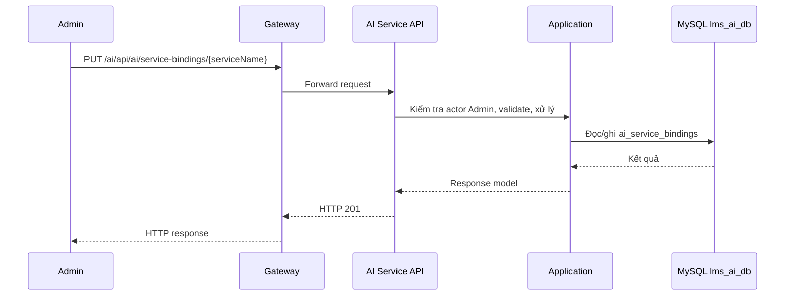

# `PUT /ai/api/ai/service-bindings/{serviceName}` — Gán (hoặc đổi) model AI cho service

API contract: [`put-service-binding.md`](../../api/ai-service/endpoints/put-service-binding.md)

## Mục tiêu

Admin chọn model cho một service. Idempotent: gọi lại với cùng model không đổi kết quả.

## Actor và thành phần

- Admin (actor `ADMIN`).
- API Gateway (route `/ai/{**catch-all}`, bỏ tiền tố `/ai`).
- AI Service (Api → Application → Infrastructure).
- MySQL `lms_ai_db`.

## Điều kiện trước

- Header `X-Actor-Type: ADMIN` và `X-Actor-Id` hợp lệ.
- Body/query đúng contract trong tài liệu API.

## UML luồng chạy

## Luồng chính

1. Admin gửi `PUT /ai/api/ai/service-bindings/{serviceName}`.
2. Handler validate service và `modelId`, đọc model và provider, kiểm tra cả hai `ACTIVE`.
3. Repository upsert binding.
4. API trả `201` nếu tạo mới, `200` nếu thay.

## Luồng lỗi

- `400`: `VALIDATION_FAILED`: `serviceName` không được hỗ trợ hoặc `modelId` sai.
- `403`: Actor không phải Admin (header actor thiếu/sai định dạng trả `400`).
- `404`: `AI_MODEL_NOT_FOUND` hoặc `AI_PROVIDER_NOT_FOUND`.
- `409`: `AI_REFERENCE_INACTIVE`: model hoặc provider đang `INACTIVE`.

## Dữ liệu và side effects

- Upsert `ai_service_bindings` theo unique `service_name` (mỗi service một binding).
- Phase 2: worker sẽ tra binding này để biết gọi model nào.

## Test mapping

- Unit: [`docs/tests/ai-service/unit.md`](../../tests/ai-service/unit.md).
- Component: [`docs/tests/ai-service/component.md`](../../tests/ai-service/component.md).
