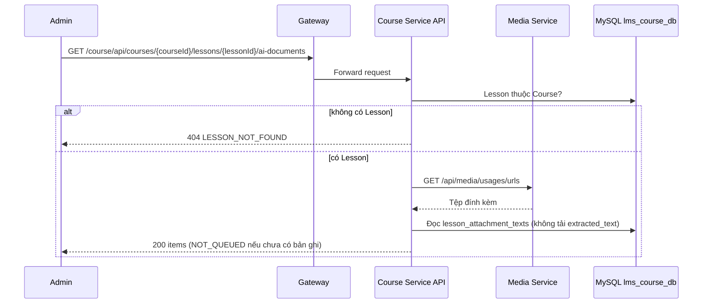

# `GET /course/api/courses/{courseId}/lessons/{lessonId}/ai-documents` — Trạng thái trích xuất tài liệu của Lesson

API contract: [`GET Trạng thái trích xuất tài liệu`](../../api/course-service/endpoints/get-course-lesson-ai-documents.md)

## Mục tiêu

Cho UI hiển thị (và poll) trạng thái trích xuất của từng tài liệu đính kèm mà không ghi dữ liệu.

## Actor và thành phần

- Admin; API Gateway; Course Service; Media Service; MySQL `lms_course_db`.

## Điều kiện trước

- Header `X-Actor-Type: ADMIN`, `X-Actor-Id` hợp lệ; Lesson thuộc Course.

## UML luồng chạy

## Luồng chính

1. Kiểm tra Lesson, đọc tệp đính kèm và bản ghi trích xuất.
2. Hợp nhất: tệp chưa có bản ghi hiện `NOT_QUEUED` (hoặc `UNSUPPORTED` nếu định dạng không hỗ trợ).
3. Trả `200` với `no-store`.

## Luồng lỗi

- `400`, `403`, `404 LESSON_NOT_FOUND`, `500 UNEXPECTED_ERROR` khi Media Service lỗi.

## Dữ liệu và side effects

- Không ghi dữ liệu. Không trả văn bản đã trích xuất.

## Test mapping

- Unit: [`docs/tests/course-service/unit.md`](../../tests/course-service/unit.md) (`LessonAiHandlersTests`, `DocumentExtractionTests`, `LessonAiJobProcessingTests`).
- Component: [`docs/tests/course-service/component.md`](../../tests/course-service/component.md) (`LessonAiEndpointsComponentTests`).
