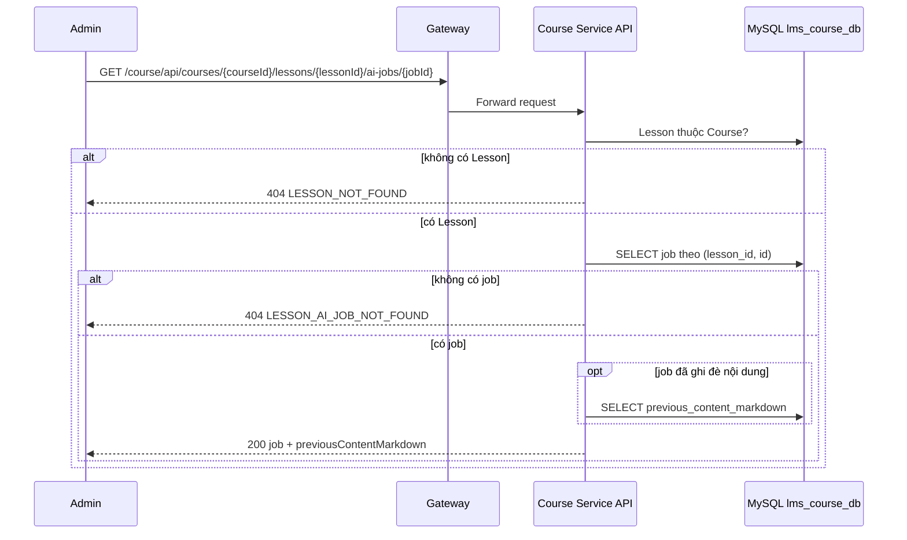

# `GET /course/api/courses/{courseId}/lessons/{lessonId}/ai-jobs/{jobId}` — Chi tiết một job AI của Lesson

API contract: [`GET Chi tiết job AI`](../../api/course-service/endpoints/get-course-lesson-ai-job-by-id.md)

## Mục tiêu

Xem một job và nội dung Lesson cũ (nếu job đã ghi đè) để admin khôi phục khi cần.

## Actor và thành phần

- Admin; API Gateway; Course Service; MySQL `lms_course_db`.

## Điều kiện trước

- Header `X-Actor-Type: ADMIN`, `X-Actor-Id` hợp lệ; Lesson thuộc Course; job thuộc Lesson.

## UML luồng chạy

## Luồng chính

1. Kiểm tra Lesson và job thuộc Lesson. 2. Nếu `hasPreviousContent`, đọc thêm bản nội dung cũ. 3. Trả `200`.

## Luồng lỗi

- `400`, `403`, `404 LESSON_NOT_FOUND`, `404 LESSON_AI_JOB_NOT_FOUND`.

## Dữ liệu và side effects

- Không ghi dữ liệu.

## Test mapping

- Unit: [`docs/tests/course-service/unit.md`](../../tests/course-service/unit.md) (`LessonAiHandlersTests`, `DocumentExtractionTests`, `LessonAiJobProcessingTests`).
- Component: [`docs/tests/course-service/component.md`](../../tests/course-service/component.md) (`LessonAiEndpointsComponentTests`).
