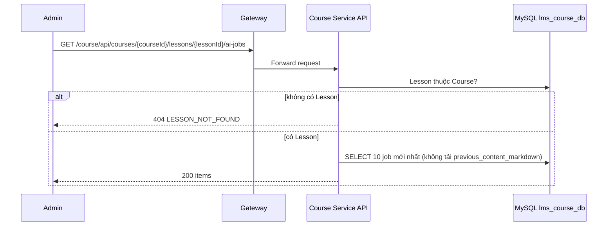

# `GET /course/api/courses/{courseId}/lessons/{lessonId}/ai-jobs` — Các job AI gần nhất của Lesson

API contract: [`GET Các job AI của Lesson`](../../api/course-service/endpoints/get-course-lesson-ai-jobs.md)

## Mục tiêu

Cho UI hiện tiến độ, lỗi và liên kết Quiz `DRAFT` của các job AI gần nhất.

## Actor và thành phần

- Admin; API Gateway; Course Service; MySQL `lms_course_db`.

## Điều kiện trước

- Header `X-Actor-Type: ADMIN`, `X-Actor-Id` hợp lệ; Lesson thuộc Course.

## UML luồng chạy

## Luồng chính

1. Kiểm tra Lesson. 2. Đọc tối đa 10 job theo `created_at DESC`. 3. Trả `200`, `no-store`.

## Luồng lỗi

- `400` `VALIDATION_FAILED`, `403`, `404 LESSON_NOT_FOUND`.

## Dữ liệu và side effects

- Không ghi dữ liệu.

## Test mapping

- Unit: [`docs/tests/course-service/unit.md`](../../tests/course-service/unit.md) (`LessonAiHandlersTests`, `DocumentExtractionTests`, `LessonAiJobProcessingTests`).
- Component: [`docs/tests/course-service/component.md`](../../tests/course-service/component.md) (`LessonAiEndpointsComponentTests`).
