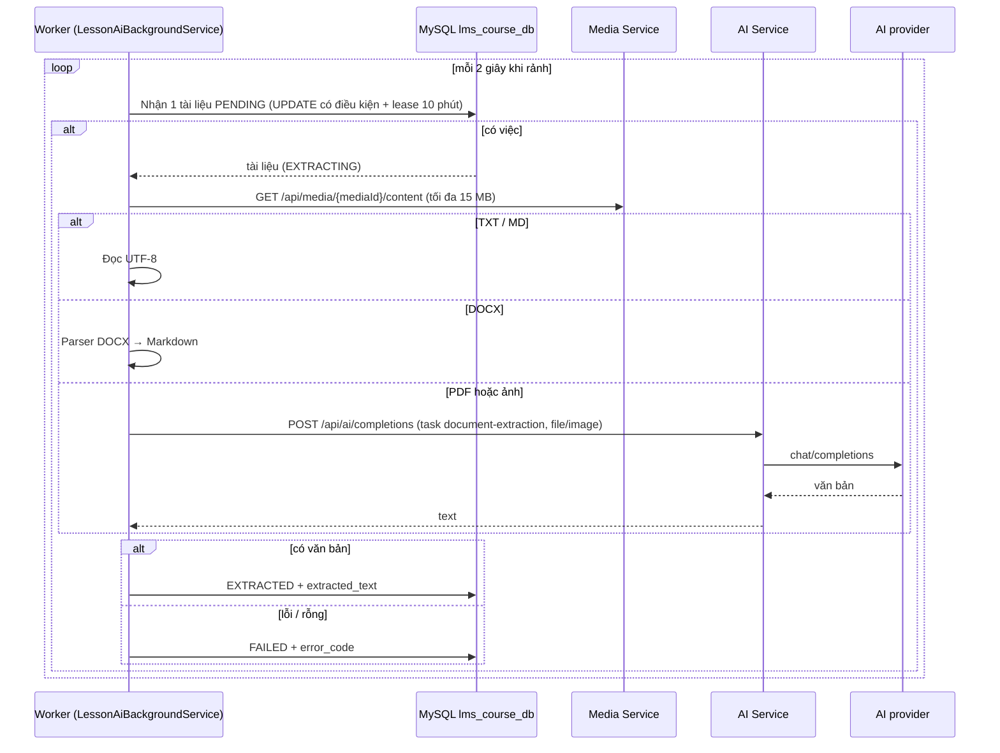
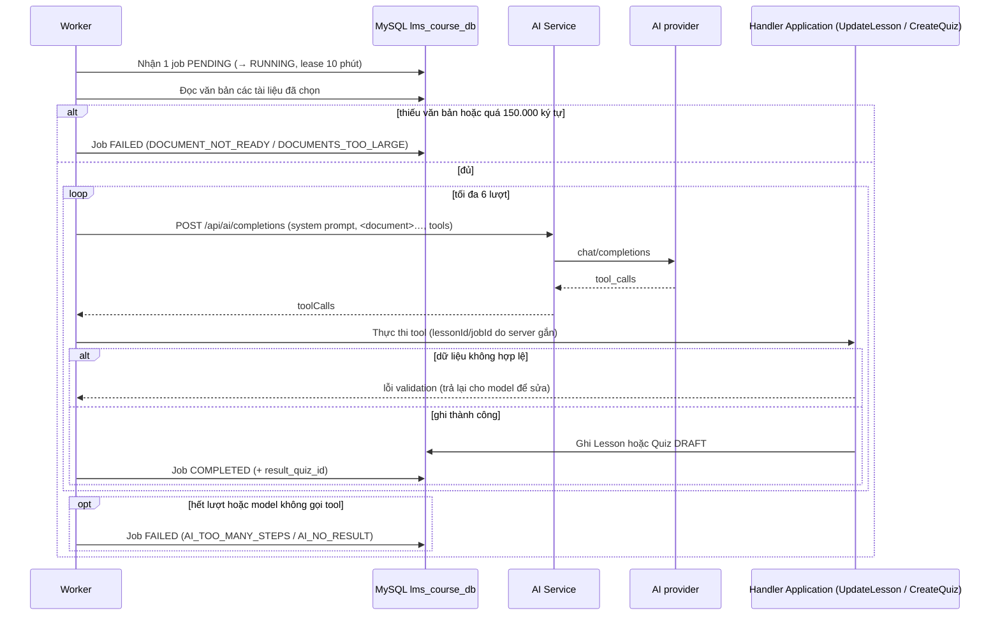

# Soạn nội dung Lesson bằng AI (luồng tổng thể và worker nền)

Tài liệu này mô tả toàn bộ pipeline của năm endpoint `ai-documents` / `ai-jobs` và phần chạy nền không có endpoint HTTP riêng. Từng endpoint có flow riêng:

- [`POST …/ai-documents/sync`](post-course-lesson-ai-documents-sync.md), [`GET …/ai-documents`](get-course-lesson-ai-documents.md)
- [`POST …/ai-jobs`](post-course-lesson-ai-jobs.md), [`GET …/ai-jobs`](get-course-lesson-ai-jobs.md), [`GET …/ai-jobs/{jobId}`](get-course-lesson-ai-job-by-id.md)
- AI Service: [`POST /ai/api/ai/completions`](../ai/post-completions.md)

## Ba tác vụ LLM

| Khóa binding | Vai trò | Đầu ra |
| --- | --- | --- |
| `document-extraction` | Đọc PDF/ảnh và chép lại thành Markdown. TXT/MD đọc thẳng, DOCX qua parser trong Course Service, không tốn lượt gọi LLM. | Văn bản lưu ở `lesson_attachment_texts`. |
| `lesson-synthesis` | Tổng hợp các tài liệu đã chọn thành một bài học Markdown. | Gọi tool `save_lesson_content` ghi vào `lessons.content_markdown`. |
| `quiz-authoring` | Soạn câu hỏi trắc nghiệm từ các tài liệu đã chọn. | Gọi tool `create_quiz` tạo Quiz `DRAFT`. |

Mỗi khóa được gán model riêng ở trang **AI → Gán model**.

## Trích xuất tài liệu (worker nền)

- Nhận việc bằng `UPDATE … WHERE status='PENDING'` nên nhiều worker/instance không xử lý trùng. Tài liệu `EXTRACTING` quá hạn lease (worker chết) được nhận lại tối đa 3 lần rồi `FAILED`.
- Văn bản dài hơn 300.000 ký tự bị cắt kèm ghi chú; đầu ra model bị cắt (`finishReason = length`) cũng được ghi chú.

## Chạy job tổng hợp bài học / soạn quiz (worker nền)

Điểm an toàn:

- Model không có SQL hay schema; mỗi tool là một hàm hẹp gọi lại handler Application có sẵn (qua validation và đồng bộ media usage).
- `lessonId`, `courseId` do job quyết định. Quiz luôn `DRAFT`; chỉ admin xuất bản. Một job tối đa một lần ghi thành công.
- Ghi đè nội dung Lesson cần `overwriteContent=true`; bản cũ lưu ở `previous_content_markdown`.
- Văn bản tài liệu là dữ liệu không tin cậy: nằm trong khối `<document>`, system prompt yêu cầu không làm theo chỉ dẫn trong tài liệu.
- Job `RUNNING` quá hạn lease bị đánh dấu `FAILED` (`WORKER_INTERRUPTED`) và không chạy lại để tránh tạo trùng Quiz.

## Hành vi frontend

Panel "Soạn nội dung bằng AI" nằm trong tab **Tài liệu** của Lesson (admin): gọi `sync` khi mở và khi tệp đính kèm đổi, poll im lặng 3 giây khi còn tài liệu/job đang chạy; chọn tài liệu bằng checkbox (mặc định không chọn gì, chỉ chọn được tài liệu `EXTRACTED`); hai nút độc lập "Tự động tổng hợp bài học" và "Tự động tạo quiz"; hộp xác nhận trước khi ghi đè nội dung đang có; hiện nhãn "nội dung do AI tạo, cần kiểm tra".

## Test mapping

- Unit: [`docs/tests/course-service/unit.md`](../../tests/course-service/unit.md).
- Component: [`docs/tests/course-service/component.md`](../../tests/course-service/component.md).
- Frontend: `frontend/lms-web/src/pages/courses/components/LessonAiPanel.test.jsx`.
