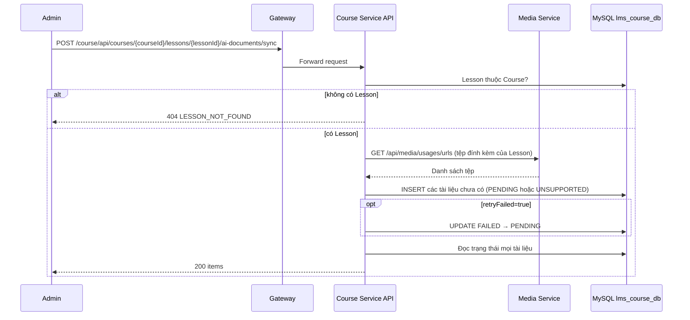

# `POST /course/api/courses/{courseId}/lessons/{lessonId}/ai-documents/sync` — Đồng bộ tài liệu đính kèm vào hàng chờ trích xuất

API contract: [`POST Đồng bộ tài liệu đính kèm`](../../api/course-service/endpoints/post-course-lesson-ai-documents-sync.md)

## Mục tiêu

Đưa tệp đính kèm mới của Lesson vào hàng chờ để worker trích xuất văn bản, và trả trạng thái mọi tài liệu cho UI.

## Actor và thành phần

- Admin (frontend gọi khi mở panel AI hoặc sau khi gắn/gỡ tệp).
- API Gateway (`/course/...`), Course Service, Media Service, MySQL `lms_course_db`.

## Điều kiện trước

- Header `X-Actor-Type: ADMIN`, `X-Actor-Id` hợp lệ; Lesson thuộc Course.

## UML luồng chạy

## Luồng chính

1. Handler kiểm tra Lesson, lấy tệp đính kèm từ Media Service.
2. Phân loại từng tệp theo MIME/đuôi tệp: hỗ trợ → `PENDING`; không hỗ trợ → `UNSUPPORTED`.
3. Chèn các bản ghi còn thiếu (idempotent theo `(lesson_id, media_id)`), tùy chọn thử lại tài liệu `FAILED`.
4. Trả danh sách trạng thái hợp nhất với thứ tự đính kèm.

## Luồng lỗi

- `400` `VALIDATION_FAILED`, `403` không phải Admin, `404` `LESSON_NOT_FOUND`.
- `500` `UNEXPECTED_ERROR` khi Media Service lỗi.

## Dữ liệu và side effects

- Ghi `lesson_attachment_texts`. Worker nền (xem [`lesson-ai-authoring.md`](lesson-ai-authoring.md)) xử lý các dòng `PENDING`.

## Test mapping

- Unit: [`docs/tests/course-service/unit.md`](../../tests/course-service/unit.md) (`LessonAiHandlersTests`, `DocumentExtractionTests`, `LessonAiJobProcessingTests`).
- Component: [`docs/tests/course-service/component.md`](../../tests/course-service/component.md) (`LessonAiEndpointsComponentTests`).
