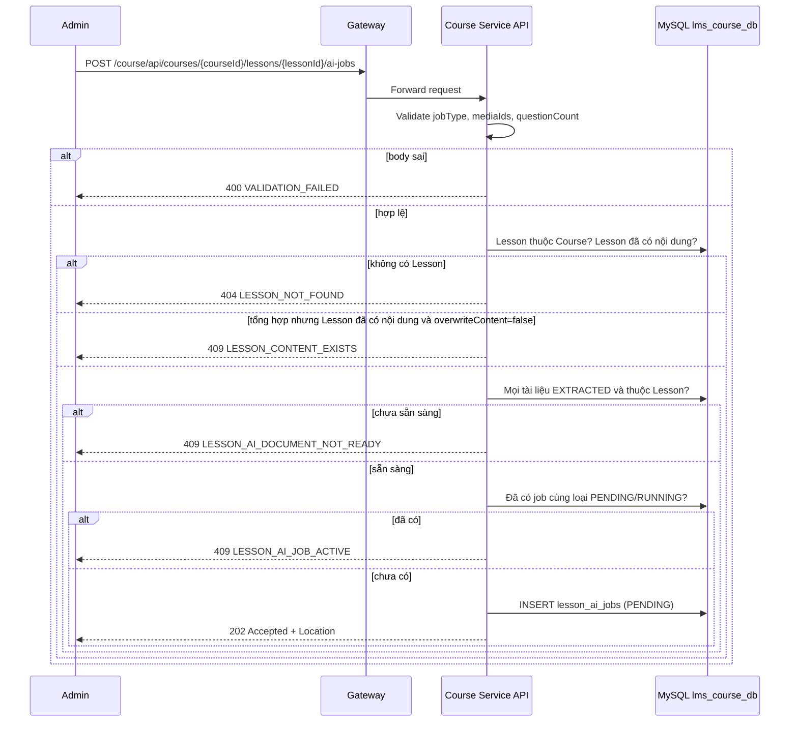

# `POST /course/api/courses/{courseId}/lessons/{lessonId}/ai-jobs` — Tạo job AI tổng hợp bài học hoặc soạn quiz

API contract: [`POST Tạo job AI`](../../api/course-service/endpoints/post-course-lesson-ai-jobs.md)

## Mục tiêu

Admin chọn tài liệu đã trích xuất rồi giao cho AI tổng hợp bài học hoặc soạn quiz; request trả ngay, kết quả do worker nền ghi vào database thông qua tool call.

## Actor và thành phần

- Admin; API Gateway; Course Service (API + worker nền); AI Service; MySQL `lms_course_db`; Media Service (đồng bộ media usage khi ghi Markdown có ảnh).

## Điều kiện trước

- Header `X-Actor-Type: ADMIN`, `X-Actor-Id` hợp lệ.
- Các tài liệu được chọn đã `EXTRACTED`; AI Service đã có binding cho `lesson-synthesis` hoặc `quiz-authoring` (nếu thiếu, job sẽ `FAILED` `AI_TASK_NOT_CONFIGURED`).

## UML luồng chạy

Việc chạy job sau khi trả `202` được mô tả trong [`lesson-ai-authoring.md`](lesson-ai-authoring.md).

## Luồng chính

1. Handler validate input, kiểm tra Lesson và xác nhận ghi đè.
2. Kiểm tra tài liệu đã trích xuất và không có job cùng loại đang hoạt động.
3. Lưu job `PENDING`, trả `202` kèm `Location` tới chi tiết job.

## Luồng lỗi

- `400` `VALIDATION_FAILED`; `403` không phải Admin; `404` `LESSON_NOT_FOUND`.
- `409` `LESSON_CONTENT_EXISTS`, `LESSON_AI_DOCUMENT_NOT_READY`, `LESSON_AI_JOB_ACTIVE`.

## Dữ liệu và side effects

- Chèn `lesson_ai_jobs`. Worker sau đó có thể: ghi `lessons.content_markdown` (tổng hợp) hoặc tạo `quizzes` `DRAFT` (soạn quiz), gọi AI Service và gửi command đồng bộ media usage cho Media Service.

## Test mapping

- Unit: [`docs/tests/course-service/unit.md`](../../tests/course-service/unit.md) (`LessonAiHandlersTests`, `DocumentExtractionTests`, `LessonAiJobProcessingTests`).
- Component: [`docs/tests/course-service/component.md`](../../tests/course-service/component.md) (`LessonAiEndpointsComponentTests`).
