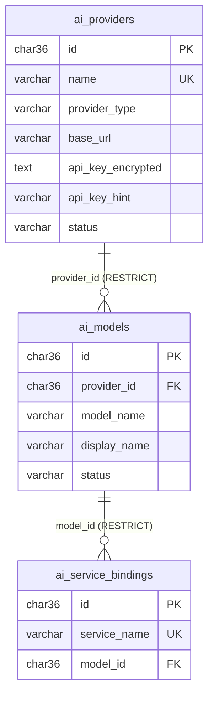

# Data model — AI Service

**Service/database sở hữu:** AI Service / `lms_ai_db`.

AI Service chỉ sở hữu cấu hình AI dùng chung: provider (loại AI + API key mã hóa), model và binding service → model. Nó không lưu nội dung prompt/kết quả, và không có FK tới database service khác. `service_name` là logical reference tới tên service. Bảng dùng InnoDB, UUID `CHAR(36)` ASCII và thời gian `DATETIME(6)` UTC. Migration: `AiService.Infrastructure/Database/Migrations/V001__create_ai_tables.sql`.

## `ai_providers`

| Cột | Kiểu / null / mặc định | Ý nghĩa |
| --- | --- | --- |
| `id` | `CHAR(36)`, PK | UUID provider. |
| `name` | `VARCHAR(100)`, `NOT NULL`, unique | Tên hiển thị cho admin. |
| `provider_type` | `VARCHAR(20)`, `NOT NULL` | `OPENAI`, `GEMINI`, `ANTHROPIC`, `MISTRAL`, `CUSTOM` (CHECK). |
| `base_url` | `VARCHAR(500)`, `NOT NULL` | Endpoint OpenAI-compatible mà OpenAI SDK sẽ gọi. |
| `api_key_encrypted` | `TEXT`, `NOT NULL` | API key mã hóa AES-256-GCM, base64 của `nonce(12) | tag(16) | ciphertext`. |
| `api_key_hint` | `VARCHAR(16)`, `NOT NULL` | `****` + 4 ký tự cuối, chỉ để nhận diện; không dùng để giải mã. |
| `status` | `VARCHAR(20)`, `NOT NULL` | `ACTIVE` hoặc `INACTIVE` (CHECK). |
| `created_at`, `updated_at` | `DATETIME(6)`, `NOT NULL` | Tạo / sửa cuối (UTC). |

Ràng buộc: unique `name`; index `(status, created_at DESC)`.

## `ai_models`

| Cột | Kiểu / null / mặc định | Ý nghĩa |
| --- | --- | --- |
| `id` | `CHAR(36)`, PK | UUID model. |
| `provider_id` | `CHAR(36)`, `NOT NULL`, FK | `ai_providers.id`, `ON DELETE RESTRICT`. |
| `model_name` | `VARCHAR(100)`, `NOT NULL` | Tên model gửi cho provider, ví dụ `gpt-4o`. |
| `display_name` | `VARCHAR(100)`, `NOT NULL` | Tên hiển thị. |
| `status` | `VARCHAR(20)`, `NOT NULL` | `ACTIVE` hoặc `INACTIVE`. |
| `created_at`, `updated_at` | `DATETIME(6)`, `NOT NULL` | Tạo / sửa cuối (UTC). |

Ràng buộc: unique `(provider_id, model_name)`; index `(status, created_at DESC)`. Xóa provider còn model bị chặn (`409 AI_PROVIDER_IN_USE`).

## `ai_service_bindings`

| Cột | Kiểu / null / mặc định | Ý nghĩa |
| --- | --- | --- |
| `id` | `CHAR(36)`, PK | UUID binding. |
| `service_name` | `VARCHAR(50)`, `NOT NULL`, unique | Tên service được dùng AI, ví dụ `course-service`. Mỗi service một binding. |
| `model_id` | `CHAR(36)`, `NOT NULL`, FK | `ai_models.id`, `ON DELETE RESTRICT`. |
| `created_at`, `updated_at` | `DATETIME(6)`, `NOT NULL` | Tạo / sửa cuối (UTC). |

Ràng buộc: unique `service_name`; index `model_id`. Xóa model còn binding bị chặn (`409 AI_MODEL_IN_USE`).

## Bảo mật và vận hành

- Master key lấy từ env `AI_ENCRYPTION_KEY` (`Ai__Encryption__Key`), base64 32 byte; service từ chối khởi động nếu thiếu hoặc sai độ dài.
- Nonce 12 byte ngẫu nhiên cho mỗi lần mã hóa; sửa ciphertext hoặc dùng sai key làm giải mã thất bại.
- Database này **không** nằm trong seed/reset/backup scripts vì chứa cấu hình đã mã hóa, không phải dữ liệu mẫu.
- Chưa có bảng MassTransit; sẽ thêm ở Phase 2 khi có consumer.
