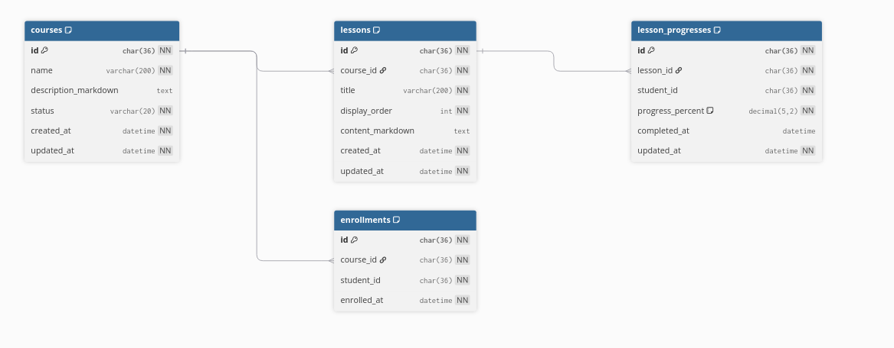

# Data model — Course Service

**Service/database sở hữu:** Course Service / `lms_course_db`.

Course Service là nguồn dữ liệu cho export CSV lớn, list/cursor pagination,
benchmark index/`EXPLAIN ANALYZE` và API minh họa N+1. Mọi UUID liên quan
Student là logical reference; không tạo foreign key sang `lms_student_db`.
Tất cả bảng dùng InnoDB, UUID `CHAR(36)` ASCII và timestamp `DATETIME(6)` UTC.

## `courses`

| Cột | Kiểu / null / mặc định | Ý nghĩa |
| --- | --- | --- |
| `id` | `CHAR(36)`, PK | UUID Course. |
| `name` | `VARCHAR(200)`, `NOT NULL` | Tên hiển thị. |
| `description_markdown` | `MEDIUMTEXT`, `NULL` | Markdown gốc; chỉ nhúng URL do Media Service cấp, không lưu HTML chưa sanitize. |
| `status` | `VARCHAR(20)`, `NOT NULL` | `DRAFT`, `PUBLISHED`, `ARCHIVED`. |
| `created_at` | `DATETIME(6)`, `NOT NULL`, `CURRENT_TIMESTAMP(6)` | Lúc tạo UTC. |
| `updated_at` | `DATETIME(6)`, `NOT NULL`, tự cập nhật | Lần sửa cuối UTC. |

Ràng buộc/chỉ mục: `chk_courses_status`;
`ix_courses_status_created_at(status, created_at DESC)` phục vụ lọc trạng thái,
mốc thời gian và `ORDER BY created_at DESC` trong benchmark.

List Course có thể tìm substring trên `name`. Đây không phải prefix/full-text
search nên chưa thêm B-tree index hoặc migration mới; khi cần SLA cho dataset lớn,
đánh giá Full-Text Search hoặc search service riêng trước khi thay đổi contract.

## `lessons`

| Cột | Kiểu / null / mặc định | Ý nghĩa |
| --- | --- | --- |
| `id` | `CHAR(36)`, PK | UUID Lesson. |
| `course_id` | `CHAR(36)`, `NOT NULL`, FK | `courses.id`, `ON DELETE CASCADE`. |
| `title` | `VARCHAR(200)`, `NOT NULL` | Tiêu đề bài học. |
| `display_order` | `INT UNSIGNED`, `NOT NULL` | Vị trí Lesson trong Course. |
| `content_markdown` | `MEDIUMTEXT`, `NULL` | Markdown gốc, có thể nhúng media URL. |
| `created_at` | `DATETIME(6)`, `NOT NULL`, `CURRENT_TIMESTAMP(6)` | Lúc tạo UTC. |
| `updated_at` | `DATETIME(6)`, `NOT NULL`, tự cập nhật | Lần sửa cuối UTC. |

`uq_lessons_course_id_display_order(course_id, display_order)` chặn trùng thứ tự
và đồng thời hỗ trợ lấy Lessons của một Course theo thứ tự, tránh query riêng cho
từng Course trong use case N+1.

## `enrollments`

| Cột | Kiểu / null / mặc định | Ý nghĩa |
| --- | --- | --- |
| `id` | `CHAR(36)`, PK | UUID lượt ghi danh. |
| `course_id` | `CHAR(36)`, `NOT NULL`, FK | Course được ghi danh; `ON DELETE CASCADE`. |
| `student_id` | `CHAR(36)`, `NOT NULL` | UUID Student logical reference, không có FK xuyên database. |
| `enrolled_at` | `DATETIME(6)`, `NOT NULL`, `CURRENT_TIMESTAMP(6)` | Lúc ghi danh UTC. |

`uq_enrollments_course_id_student_id(course_id, student_id)` bảo đảm mỗi học
viên chỉ ghi danh một lần/Course.
`ix_enrollments_student_id_enrolled_at(student_id, enrolled_at DESC)` phục vụ
lịch sử Course của một học viên.

## `lesson_progresses`

| Cột | Kiểu / null / mặc định | Ý nghĩa |
| --- | --- | --- |
| `id` | `CHAR(36)`, PK | UUID progress. |
| `lesson_id` | `CHAR(36)`, `NOT NULL`, FK | `lessons.id`, `ON DELETE CASCADE`. |
| `student_id` | `CHAR(36)`, `NOT NULL` | UUID Student logical reference. |
| `progress_percent` | `DECIMAL(5,2) UNSIGNED`, `NOT NULL`, `0` | Giá trị `0`–`100`. |
| `completed_at` | `DATETIME(6)`, `NULL` | Có giá trị khi hoàn thành; application giữ nhất quán với 100%. |
| `updated_at` | `DATETIME(6)`, `NOT NULL`, tự cập nhật | Lần cập nhật cuối UTC. |

`uq_lesson_progresses_lesson_id_student_id(lesson_id, student_id)` vừa chặn
progress trùng vừa có tiền tố `lesson_id` để join/aggregate progress theo tập
Lesson. `chk_lesson_progresses_progress_percent` giới hạn `0..100`;
`ix_lesson_progresses_student_id_updated_at(student_id, updated_at DESC)` phục
vụ trang tiến độ gần đây.

## Quiz trắc nghiệm (`V002__create_quiz_tables.sql`)

Quan hệ: `lessons` 1–N `quizzes` 1–N `quiz_questions` 1–N `quiz_options`; `quizzes` 1–N `quiz_attempts` 1–N `quiz_attempt_answers`. Mọi FK nội bộ dùng `ON DELETE CASCADE` nên xóa Lesson/Course kéo theo Quiz và bài làm (Course Service phải tự báo Media dọn usage vì FK không báo được). `student_id` là logical reference, không có FK xuyên database.

### `quizzes`

| Cột | Kiểu / null / mặc định | Ý nghĩa |
| --- | --- | --- |
| `id` | `CHAR(36)`, PK | UUID Quiz. |
| `lesson_id` | `CHAR(36)`, `NOT NULL`, FK | `lessons.id`. |
| `title` | `VARCHAR(200)`, `NOT NULL` | Tiêu đề. |
| `description_markdown` | `MEDIUMTEXT`, `NULL` | Mô tả Markdown, server render HTML đã sanitize. |
| `display_order` | `INT UNSIGNED`, `NOT NULL` | Thứ tự trong Lesson; `uq(lesson_id, display_order)`. |
| `status` | `VARCHAR(20)`, `NOT NULL` | `DRAFT` hoặc `PUBLISHED` (`chk_quizzes_status`); Student chỉ thấy `PUBLISHED`. |
| `created_at`, `updated_at` | `DATETIME(6)` | UTC. |

### `quiz_questions`

`question_markdown` (`MEDIUMTEXT`, bắt buộc), `question_type` (`SINGLE_CHOICE` | `MULTIPLE_CHOICE`), `points` (`DECIMAL(6,2)`, CHECK `> 0` và `<= 100`), `display_order` với `uq(quiz_id, display_order)`. Tổng điểm Quiz không lưu cột mà tính `SUM(points)` khi đọc để không lệch dữ liệu.

### `quiz_options`

`option_markdown` (`TEXT`, bắt buộc), `is_correct` (`TINYINT(1)`), `display_order` với `uq(question_id, display_order)`.

### `quiz_attempts`

| Cột | Ý nghĩa |
| --- | --- |
| `student_id` | UUID Student (logical reference). |
| `status` | `IN_PROGRESS` hoặc `SUBMITTED`. |
| `started_at`, `updated_at`, `submitted_at` | UTC; `submitted_at` chỉ có khi đã nộp. |
| `score`, `max_score` | `DECIMAL(8,2)`, `NULL` cho đến khi nộp; `max_score` là snapshot tổng điểm lúc nộp. CHECK bảo đảm nhất quán với `status`. |
| `open_marker` | Cột sinh `STORED`: `IF(status = 'IN_PROGRESS', student_id, NULL)`. |

`uq(quiz_id, open_marker)` thay cho partial unique index (MySQL không có): mỗi học viên chỉ có tối đa một lần `IN_PROGRESS` trên mỗi Quiz, còn lần `SUBMITTED` không giới hạn (làm lại). Chỉ mục `(quiz_id, student_id, started_at DESC)` phục vụ lịch sử.

### `quiz_attempt_answers`

Mỗi dòng là một lựa chọn học viên đang chọn: `id` (PK), `attempt_id`, `question_id`, `selected_option_id` (đều FK cascade), `uq(attempt_id, question_id, selected_option_id)`. Khi `IN_PROGRESS` là bản nháp; khi `SUBMITTED` là đáp án chính thức, bất biến.

### Media usage của Quiz

Markdown của mô tả, câu hỏi và lựa chọn dùng cùng pipeline với Lesson. Usage được đồng bộ với owner `COURSE` / `QUIZ_CONTENT` / `quiz_id` (tập tham chiếu là hợp của mọi Markdown trong Quiz). Media Service cho phép owner này bằng migration Media `V011`.

## Soạn nội dung Lesson bằng AI (`V003__create_lesson_ai_tables.sql`)

Hai bảng phục vụ pipeline "tài liệu đính kèm → bài học / quiz" (xem [`lesson-ai-authoring.md`](../../business-flows/course-learning/lesson-ai-authoring.md)). Cả hai có FK `lesson_id → lessons.id ON DELETE CASCADE`; `media_id`, `course_id` và các cột actor là logical reference (không FK xuyên database).

### `lesson_attachment_texts`

Văn bản trích xuất của từng tệp đính kèm.

| Cột | Kiểu / null / mặc định | Ý nghĩa |
| --- | --- | --- |
| `id` | `CHAR(36)`, PK | UUID bản trích xuất. |
| `lesson_id` | `CHAR(36)`, `NOT NULL`, FK | Lesson sở hữu tài liệu. |
| `media_id` | `CHAR(36)`, `NOT NULL` | Media đính kèm; unique cùng `lesson_id`. |
| `file_name`, `content_type` | `VARCHAR(255)` / `VARCHAR(150)`, `NOT NULL` | Tên tệp và MIME tại lúc đưa vào hàng chờ, để hiển thị và phân loại. |
| `status` | `VARCHAR(20)`, `NOT NULL` | `PENDING`, `EXTRACTING`, `EXTRACTED`, `FAILED`, `UNSUPPORTED` (CHECK). |
| `extracted_text` | `MEDIUMTEXT`, `NULL` | Markdown đã trích xuất; chỉ có khi `EXTRACTED`. Không bao giờ trả qua API. |
| `error_code`, `error_message` | `VARCHAR(60)` / `VARCHAR(500)`, `NULL` | Lỗi an toàn khi `FAILED`/`UNSUPPORTED`. |
| `attempts` | `INT`, `NOT NULL`, mặc định `0` | Số lần worker đã nhận; tối đa 3 lần khi worker chết giữa chừng. |
| `locked_until` | `DATETIME(6)`, `NULL` | Hạn lease của worker (UTC). |
| `requested_by` | `CHAR(36)`, `NOT NULL` | Admin yêu cầu; dùng làm actor khi gọi AI Service. |
| `created_at`, `updated_at` | `DATETIME(6)`, `NOT NULL` | Tạo / sửa cuối (UTC). |

Ràng buộc: `uq(lesson_id, media_id)` (đồng bộ idempotent); index `(status, created_at)` cho worker nhận việc.

### `lesson_ai_jobs`

Mỗi dòng là một lần admin giao việc cho AI.

| Cột | Kiểu / null / mặc định | Ý nghĩa |
| --- | --- | --- |
| `id` | `CHAR(36)`, PK | UUID job. |
| `lesson_id` | `CHAR(36)`, `NOT NULL`, FK | Lesson mà job ghi kết quả vào. |
| `course_id` | `CHAR(36)`, `NOT NULL` | Course của Lesson, dùng khi gọi handler cập nhật. |
| `job_type` | `VARCHAR(30)`, `NOT NULL` | `SYNTHESIZE_LESSON` hoặc `GENERATE_QUIZ` (CHECK). |
| `status` | `VARCHAR(20)`, `NOT NULL` | `PENDING`, `RUNNING`, `COMPLETED`, `FAILED` (CHECK). |
| `media_ids_json` | `JSON`, `NOT NULL` | Mảng UUID tài liệu admin đã chọn. |
| `question_count` | `INT`, `NULL` | Số câu yêu cầu khi `GENERATE_QUIZ`. |
| `overwrite_content` | `TINYINT(1)`, `NOT NULL`, mặc định `0` | Admin đã xác nhận ghi đè nội dung Lesson. |
| `previous_content_markdown` | `MEDIUMTEXT`, `NULL` | Nội dung Lesson trước khi job ghi đè, để khôi phục. |
| `result_quiz_id` | `CHAR(36)`, `NULL` | Quiz `DRAFT` do job tạo. |
| `step_count` | `INT`, `NOT NULL`, mặc định `0` | Số lượt gọi model. |
| `error_code`, `error_message` | `VARCHAR(60)` / `VARCHAR(500)`, `NULL` | Lỗi an toàn khi `FAILED`. |
| `locked_until` | `DATETIME(6)`, `NULL` | Hạn lease của worker (UTC); job `RUNNING` quá hạn bị `FAILED` (`WORKER_INTERRUPTED`) và không chạy lại. |
| `created_by` | `CHAR(36)`, `NOT NULL` | Admin tạo job; actor khi gọi AI Service và ghi dữ liệu. |
| `created_at`, `updated_at`, `started_at`, `finished_at` | `DATETIME(6)` | Mốc thời gian (UTC); `started_at`/`finished_at` có thể `NULL`. |

Index `(lesson_id, created_at DESC)` (danh sách job của Lesson) và `(status, created_at)` (worker nhận job). "Tối đa một job đang hoạt động mỗi loại trong Lesson" được kiểm tra ở Application, không có unique index.

## Chỉ mục cho yêu cầu hiệu năng

| Use case | Chỉ mục | Trạng thái |
| --- | --- | --- |
| `WHERE status = ? AND created_at >= ? ORDER BY created_at DESC LIMIT ?` | `(status, created_at DESC)` | Đã có. |
| Cursor `created_at DESC, id DESC` ổn định | `(created_at DESC, id DESC)` | Chỉ tạo bằng migration khi endpoint thực tế chọn sort này. |
| Lessons theo Course | `(course_id, display_order)` | Đã có qua unique key. |
| Aggregate progress theo Lesson | `(lesson_id, student_id)` | Đã có qua unique key. |

CSV streaming, N+1, index và pagination không cần bảng hay Outbox/Inbox mới.
Course hiện không publish/consume message nghiệp vụ. Nếu sau này Course vừa ghi
database vừa publish `CoursePublishedV1`, phải thêm `OutboxState` và
`OutboxMessage`; nếu consume message có side effect, thêm cả `InboxState`.

## Seed và migration

`V001__create_learning_tables.sql`, `V002__create_quiz_tables.sql` và `V003__create_lesson_ai_tables.sql` là migration nguồn sự thật. Seeder tạo 100k
Course, 1–5 Lesson/Course và Enrollment sử dụng `student_id` xác định được từ
Student seed; không seed `lesson_progresses`. Seed không thuộc migration và
không ghi `schema_migrations`.

Xem thêm: [Student Service](../student-service/data-model.md),
[Media Service](../media-service/data-model.md),
[Notification Service](../notification-service/data-model.md),
[Scheduler Service](../scheduler-service/data-model.md).
